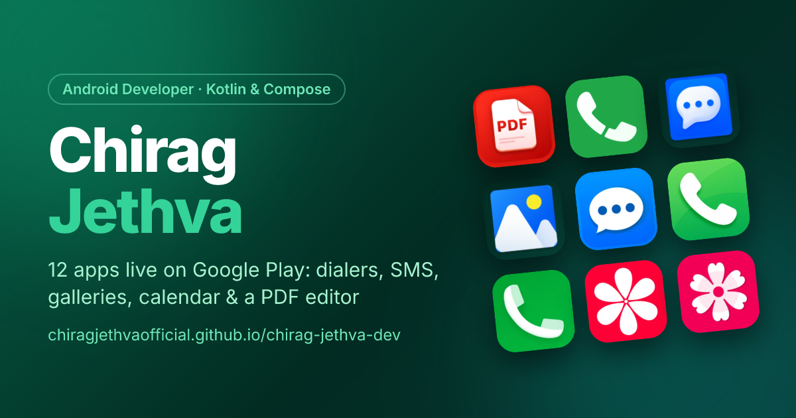

<div align="center">

<a href="https://chiragjethvaofficial.github.io/">
  
</a>

# Chirag Jethva | Portfolio

**Android developer · Kotlin & Jetpack Compose · apps live on Google Play**

[](https://github.com/chiragjethvaofficial/chiragjethvaofficial.github.io/actions)


</div>

A fast, pre-rendered portfolio site showcasing Android apps, technical case studies and articles.
Every app and article is a Markdown file, validated on every build.

## Features

- **Projects:** every app with Google Play screenshots (zoomable lightbox), features, technical highlights and a written case study. Search and filters are synced to the URL.
- **Dev Notes:** technical articles with a table of contents, syntax highlighting and RSS/Atom feeds.
- **Search:** typo-tolerant full-text search across pages, apps, articles and their sections (<kbd>Ctrl</kbd>/<kbd>⌘</kbd> + <kbd>K</kbd>).
- **About:** a tech explorer (pick a skill to see the apps that use it) and an interactive career timeline.
- **SEO:** static HTML for every route, per-page metadata, JSON-LD, sitemap and an auto-generated share image per page.
- **PWA:** installable, works offline, with optimised WebP images. Dark mode follows the system setting.

## Tech stack

| Area | Tools |
| --- | --- |
| Framework | Vue 3, Vue Router, `vite-ssg` (static pre-rendering) |
| Styling | Tailwind CSS v4 + typography plugin |
| Content | Markdown via `unplugin-vue-markdown`, Shiki highlighting, zod validation |
| Search | MiniSearch |
| Build extras | satori + resvg (share images), `feed` (RSS), `vite-plugin-pwa`, sharp |
| Hosting | GitHub Pages via GitHub Actions |

## Getting started

Requires **Node.js 24** (the version used in CI).

```bash
npm ci
npm run dev       # http://localhost:5173 (draft articles are visible)
```

| Command | What it does |
| --- | --- |
| `npm run dev` | Start the dev server |
| `npm run check` | Validate all content: schemas, images, cross-references, code snippets, secrets |
| `npm run build` | Pre-render every page, plus sitemap, robots.txt, feeds, share images and service worker |
| `npm run preview` | Serve the production build locally |
| `npm run build:drafts` | Local build that includes draft articles (never deploy this) |
| `npm run icons` | Normalise app icons to 256px WebP and regenerate favicons/PWA icons |
| `npm run screenshots -- <slug>` | Fetch a live app's screenshots from its Google Play listing |
| `npm run play-meta -- <slug>` | Record the Google Play developer account of a live app |
| `npm run og` | Regenerate share images (and the README banner `public/og.png`) |

## Project structure

```
├── content/
│   ├── projects/<slug>.md   # one app per file: frontmatter + case study
│   ├── blog/<slug>.md       # one article per file
│   └── snippets/<slug>.md   # code samples for the home-page showcase
├── docs/CONTENT.md          # content fields and rules
├── public/                  # static files: app icons, screenshots, favicons
├── scripts/                 # content checks, share images, feeds, icons, Play metadata
├── src/
│   ├── components/          # UI components (blog/ holds article widgets)
│   ├── composables/         # SEO, internal links, search palette state
│   ├── content/             # zod schemas + browser content loader
│   ├── data/
│   │   ├── site.js          # site URL and base path (single source of truth)
│   │   └── portfolio.js     # profile, skills, experience, navigation
│   ├── utils/search.js      # full-text search index
│   ├── views/               # route pages
│   └── style.css            # Tailwind theme and Markdown styles
└── vite.config.js           # Markdown, PWA, pre-rendered routes, sitemap/feeds/share images
```

## Editing content

| To change… | Edit |
| --- | --- |
| An app | `content/projects/<slug>.md` |
| An article | `content/blog/<slug>.md` (`draft: true` keeps it out of production) |
| Name, bio, email, socials, skills, experience | `src/data/portfolio.js` |
| Brand colours | `--color-brand-*` in `src/style.css` |

Field rules for every content type are in [`docs/CONTENT.md`](docs/CONTENT.md). Run `npm run check` after changes: it
reports the exact file and field of any problem.

## Configuration

The public URL is set in one place, [`src/data/site.js`](src/data/site.js):

```js
export const SITE_URL = 'https://chiragjethvaofficial.github.io'
```

The Vite base path, router, asset URLs, canonical links, sitemap, feeds and PWA scope all derive from it. To move to a
custom domain, set `SITE_URL` to the domain and add a `public/CNAME` file containing it.

## Deployment

Every push to `main` runs [`.github/workflows/deploy.yml`](.github/workflows/deploy.yml):
`npm ci` → `npm run check` → `npm run build` → GitHub Pages.

One-time setup: **Settings → Pages → Build and deployment → Source: GitHub Actions**.
